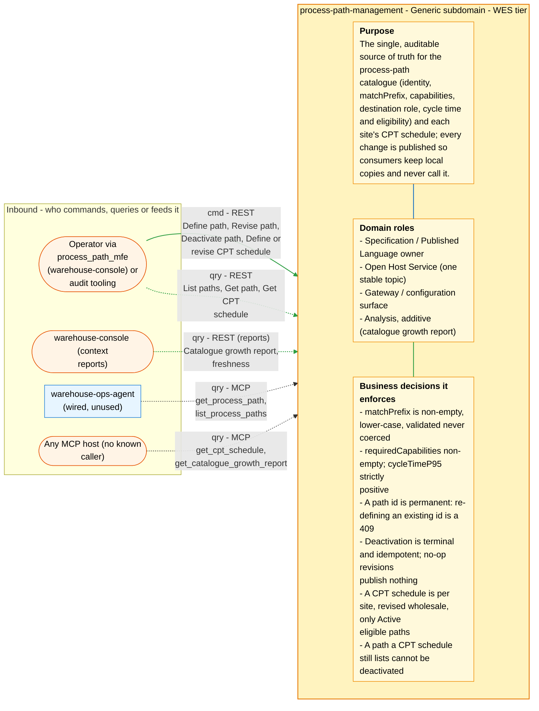
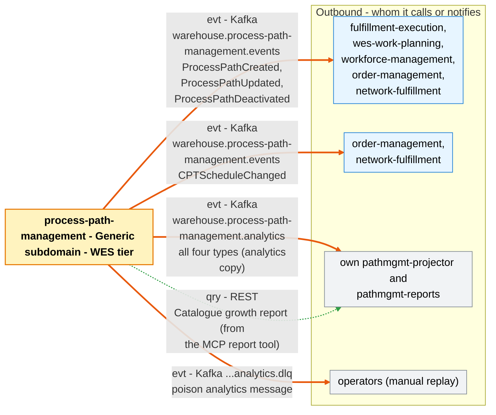

# Bounded Context Canvas

Following the [ddd-crew Bounded Context Canvas v5](https://github.com/ddd-crew/bounded-context-canvas).
Part of the [DDD artifact pack](./ddd-artifacts.md). Every message row maps
to a real route (`internal/adapters/inbound/http/server.go`,
`reports_handler.go`), MCP tool (`internal/adapters/inbound/mcp/tools.go`,
`report_tool.go`) or Kafka topic/type
(`internal/adapters/kafka/cloudevents/types.go`).

## Canvas at a glance

Two pictures of the sections below, laid out like the ddd-crew canvas:
first the inbound collaborators feeding this context (purpose, domain roles
and the business decisions it enforces), then the outbound collaborators it
calls or notifies. Arrows follow the message type: **solid blue**
commands (`cmd`), **dotted green** queries (`qry`), **thick orange** events
(`evt`); each arrow names its channel and the messages it carries. Box shapes
mark the collaborator kind: rounded = people, UI or any client; blue =
sibling bounded context; double border = external system or platform;
grey = this context's own projector, reports or dead-letter path; dashed =
published today with no consumer. Channel names on the arrows are
abbreviated (REST, MCP, Kafka, HTTP, port); the Inbound and Outbound
Communication tables carry the exact route, tool, topic and CloudEvents
type for every message.

### Inbound

### Outbound

Source: the Inbound Communication and Outbound Communication tables of this
page, which map to `internal/adapters/inbound/{http,kafka,mcp}` and `internal/adapters/outbound/`. The diagram omits assumptions, verification metrics, open
questions and the ubiquitous language (sections below), the relationship
pattern per message (OHS, ACL, Conformist, Customer/Supplier - see the
tables) and anything the tables mark as deprecated or platform-only
(health probes).

## Name

**Process Path Management** (`process-path-management`, CloudEvents
subdomain `wes`, short name `pathmgmt`).

## Purpose

Be the single, auditable source of truth for the **process-path
catalogue** — a path's canonical identity (`PathId`), the `matchPrefix`
rule consumers use to resolve a caller-supplied id to a path family,
whether it is `Direct`, the capabilities a station/associate must hold to
work it, its optional destination location role, and its fulfillment
capability contract (`cycleTimeP95`, `eligibility`) — plus each site's
recurring **CPT schedule**. It replaced a static YAML file that three
services boot-loaded independently, and it publishes every change as a
Kafka event so consumers keep local copies without ever calling it.

## Strategic Classification

| Axis | Verdict |
| --- | --- |
| Domain | **Generic** subdomain ([ADR 0001](../adr/0001-process-path-management-bounded-context.md); see the [Core Domain Chart](./core-domain-chart.md)) |
| Business Model | **Compliance / enabler** — no revenue lever of its own; it makes the Core contexts' routing, planning and promise consistent |
| Evolution | **Custom-built**, heading towards product/commodity |

## Domain Roles

| Role | Applies? | Note |
| --- | --- | --- |
| Specification / Published Language owner | **Yes** | Defines the process-path and CPT-schedule language other contexts conform to. |
| Open Host Service | **Yes** | One stable topic `warehouse.process-path-management.events` for every consumer. |
| Gateway / configuration | **Yes** | Operator-facing configuration surface (REST + `process_path_mfe`). |
| Analysis | Additive | Own "Process Path Catalogue Growth & Change" report (ADR 0007). |
| Execution / Workflow | No | Never claims, assigns or completes work. |

## Inbound Communication

| Collaborator | Message | Type | Channel | Relationship |
| --- | --- | --- | --- | --- |
| Operator / `process_path_mfe` (warehouse-console) | Define path | Command | REST `POST /process-paths` (Idempotency-Key when Postgres is wired) | OHS, Customer |
| Operator / `process_path_mfe` | Revise path | Command | REST `PUT /process-paths/{pathId}` | OHS, Customer |
| Operator / `process_path_mfe` | Deactivate path | Command | REST `DELETE /process-paths/{pathId}` | OHS, Customer |
| Operator / `process_path_mfe` | List paths (`?all=true` for audit view) | Query | REST `GET /process-paths` | OHS |
| Operator / audit tooling | Get path | Query | REST `GET /process-paths/{pathId}` | OHS |
| Operator | Define or revise CPT schedule | Command | REST `PUT /sites/{siteId}/cpt-schedule` | OHS |
| Operator | Get CPT schedule | Query | REST `GET /sites/{siteId}/cpt-schedule` | OHS |
| Kubernetes probes | Liveness / readiness | Query | REST `GET /healthz`, `GET /readyz` | Infrastructure |
| warehouse-console (context reports) | Catalogue growth report | Query | REST `GET /reports/catalogue-growth` on `pathmgmt-reports` | OHS |
| warehouse-console (context reports) | Report freshness | Query | REST `GET /reports/catalogue-growth/freshness` on `pathmgmt-reports` | OHS |
| warehouse-ops-agent (wired, unused) | Get process path | Query | MCP `get_process_path` | OHS, Customer |
| warehouse-ops-agent (wired, unused) | List process paths | Query | MCP `list_process_paths` | OHS, Customer |
| Any MCP host (no known caller) | Get CPT schedule | Query | MCP `get_cpt_schedule` | OHS |
| Any MCP host (no known caller) | Catalogue growth report | Query | MCP `get_catalogue_growth_report` (only when `REPORTS_BASE_URL` is set) | OHS |
| Own `pathmgmt-projector` | ProcessPathCreated / Updated / Deactivated | Event | Kafka `warehouse.process-path-management.analytics`, types `com.warehouse.wes.process-path-management.processpath.*` | Internal (own topic) |

No sibling context sends this context a command or event.

## Outbound Communication

| Collaborator | Message | Type | Channel | Relationship |
| --- | --- | --- | --- | --- |
| fulfillment-execution, wes-work-planning, workforce-management, order-management, network-fulfillment | ProcessPathCreated | Event | Kafka `warehouse.process-path-management.events`, `com.warehouse.wes.process-path-management.processpath.ProcessPathCreated` | OHS + PL → CF |
| same five | ProcessPathUpdated | Event | same topic, `com.warehouse.wes.process-path-management.processpath.ProcessPathUpdated` | OHS + PL → CF |
| same five | ProcessPathDeactivated | Event | same topic, `com.warehouse.wes.process-path-management.processpath.ProcessPathDeactivated` | OHS + PL → CF |
| order-management, network-fulfillment | CPTScheduleChanged | Event | same topic, `com.warehouse.wes.process-path-management.cptschedule.CPTScheduleChanged` | OHS + PL → CF |
| Own `pathmgmt-projector` | all four types (analytics copy) | Event | Kafka `warehouse.process-path-management.analytics` | Internal |
| Own `pathmgmt-reports` | Catalogue growth report | Query | REST `GET /reports/catalogue-growth` from the MCP report tool | Internal |
| Operators (manual replay) | Poison analytics message | Event | Kafka `warehouse.process-path-management.analytics.dlq` | Internal |

No outbound call to any sibling — banned and enforced by
`TestNoSiblingContextOutboundCalls`. See the [Context Map](../ecosystem/context-map.md).

## Ubiquitous Language

Full glossary with code identifiers: [Ubiquitous Language](./ubiquitous-language.md).
Top terms: **ProcessPath**, **PathId**, **MatchPrefix**, **Direct**,
**Capability** (required capabilities), **DestinationLocationRole**,
**CycleTimeP95**, **Eligibility**, **Status** (ACTIVE / DEACTIVATED),
**CPTSchedule**, **Cutoff**, **SiteId**.

## Business Decisions

1. `matchPrefix` must be non-empty and lower-case — validated, never
   coerced (`ErrEmptyMatchPrefix`, `ErrMatchPrefixNotLowercase`).
2. `requiredCapabilities` must be non-empty (`ErrNoRequiredCapabilities`).
3. `cycleTimeP95` must be strictly positive (`ErrInvalidCycleTime`).
4. `destinationLocationRole` is optional, one of `Drop`/`WorkCenter`/
   `Shipping`, immutable, never validated live against facility-layout.
5. A path id is permanent: re-defining any existing id (active or
   deactivated) is a 409 (`ErrPathAlreadyExists`), including when two
   defines of the same id race (creation is insert-only).
6. Deactivation is terminal and idempotent; a deactivated path cannot be
   revised (`ErrPathDeactivated`).
7. No-op revisions and repeated deactivations publish nothing.
8. A CPT schedule is per site, revised wholesale, needs a valid IANA
   timezone, at least one cutoff and unique `cptId`s; every
   `eligiblePathIds` entry must be an Active path (`ErrIneligiblePathId`,
   checked in the use case).
9. Concurrent writers are detected by a version column and answered with
   409 `concurrent-modification` (ADR 0017).
10. A path that a CPT schedule still lists cannot be deactivated: 409
    `path-referenced-by-cpt-schedule` until the schedule is revised
    (`ErrPathReferencedByCPTSchedule`, ADR 0026). The concurrent
    define-vs-deactivate race is closed with row locks (ADR 0028).

## Assumptions

- Consumers keep their own local read model and never call this service
  on their hot path.
- The capability, product-attribute, site and location-role vocabularies
  are owned elsewhere and stay in sync by convention (SKU handling
  classification such as hazmat or fragile: `product-master`; site and
  location role: `facility-layout`).
- A path is live the moment it is defined — no draft or approval step.
- Deactivation says nothing about work already in flight downstream.
- The catalogue is small and slow-changing (operator-configured), so
  daily report buckets and full-replay consumers are enough.

## Verification Metrics

- `process_path_management.paths.defined` counter, by `outcome`
  (`accepted`/`rejected`) — operator input quality (ADR 0019).
- `process_path_management.outbox.lag_seconds` gauge — age of the oldest
  unpublished outbox row; 0 when drained (ADR 0018).
- `GET /reports/catalogue-growth/freshness` → `lagSeconds` — analytics
  read-model lag (ADR 0007).
- Number of live consumers of `warehouse.process-path-management.events`:
  5 today (see the [Context Map](../ecosystem/context-map.md)).
- BDD: 32 Gherkin scenarios; mutation testing on `internal/domain` gated at
  99%.

## Open Questions

- Should the `destination_location_role` field, decoded by three
  consumers, drive any routing decision, or stay declarative?
- Should `PUT` endpoints accept an expected version (`If-Match`) so
  optimistic concurrency protects user edits end-to-end, not only the
  load-to-save window inside one request?
- Will `warehouse-ops-agent` use its wired MCP client, or should the
  surface stay unused?
- Does `Direct`'s reserved multi-hop meaning need modelling before a
  consumer needs it?
